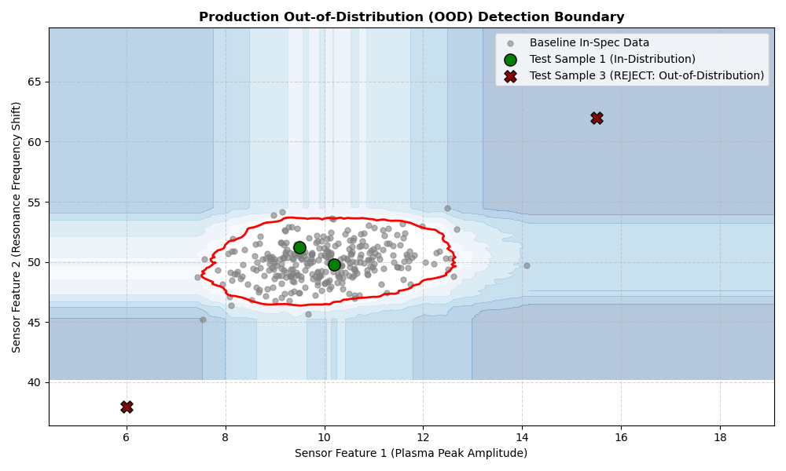

# Out-of-Distribution (OOD) Anomaly Detection for Quality Control

Identifies out-of-spec production materials or tool sensor drifts before passing signals into downstream physical prediction pipelines.

## Technical Capabilities
- Utilizes `StandardScaler` and `IsolationForest` to establish baseline production envelopes.
- Evaluates real-time samples for out-of-distribution (OOD) status.
- Plots 2D decision boundaries with anomaly contour scores.

  
